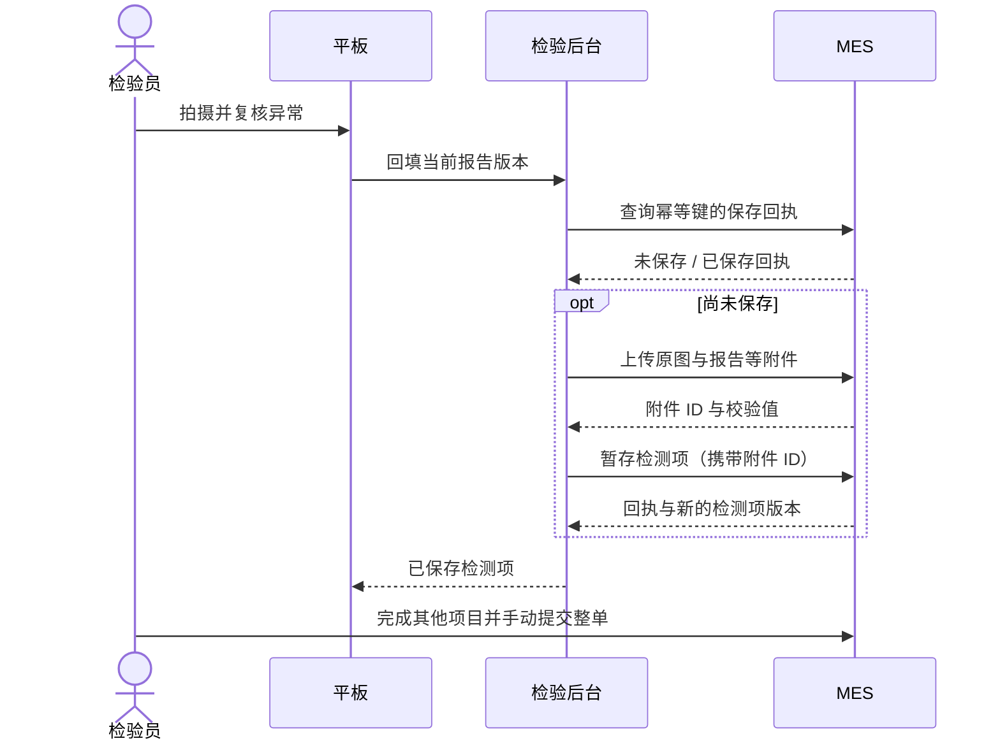

# 丝印检测与 MES 对接方案（供双方评审）

版本 1.0，2026-10-01。本文为我方提出的合同，不代表 MES 已经提供或接受这些接口。代码含本地模拟回填、独立 HTTP 模拟接收器和 HTTP 客户端适配器。

## 建议直接采用的方案

**检验后台向 MES 后台发送：附件上传 → 检测项结果保存 → 获取保存回执。只保存丝印检测项，不提交整个检验单。**

平板不直接调用 MES，不保存 MES 服务密码。任务关联以 MES 唯一任务 ID 和检测项目 ID 为准，与电脑是否打开该页面无关。实际操作人使用经过企业验证的员工 ID，不能用手输姓名代替认证。

每次发送：批次结论、抽检器件总数、不合格器件数、原始照片、逐件结构化 JSON 报告。报告通过照片 ID、裁片坐标和编号关联证据。标框图与裁片是额外附件。照片数、器件数分别计数；一个器件有多个差异只计一件不合格。



## 请 MES 方先确认六件事

1. **能否单独保存检测项？** 不改变整单最终提交状态；人工打开的旧页面再次保存时，不能静默覆盖自动回填结果。
2. **任务与项目标识是什么？** 提供稳定任务 ID、项目 ID、物料、应检数、写入权限与项目版本。显示单号若不是唯一 ID，需要映射。
3. **人员如何授权？** 推荐企业 SSO 或 MES 签发的短期任务授权。服务账号负责系统调用，员工 ID 记录实际执行者；MES 验证员工对该任务的权限。
4. **结果规则是否认可？** 默认任一最终不合格导致整项 FAIL；未检完、未复核、图像不足不得 PASS。目前客户端不发送未完成结论。
5. **附件限制是什么？** 类型、单文件与整任务大小、数量、保留期、下载授权、扫描与孤立附件清理。我方每图 ≤64 MiB、每任务 ≤100 张，不代表 MES 支持相同上限。
6. **修改与补检怎样处理？** 已回填项重新打开权限、版本升级、最终提交后的锁定及历史追溯。首轮成功回填后锁定本地版本，避免悄悄覆盖。

先认可业务语义，再实现真实服务。路径可按 MES 现有规范调整，客户端适配器集中修改即可。

## 共通协议

- 生产 HTTPS、UTF-8 JSON，开启证书验证。服务端 Bearer Token；若企业要求 OAuth2 或 mTLS，在适配层替换。平板不接触服务凭证。
- `schema_version=1.0`；时间为 Unix 秒，可含小数。若 MES 要 ISO 8601，双方统一转换。
- `Idempotency-Key=sv-{source_task_id}-r{report_revision}` 标识不可变报告。同版本重试不变；内容变化产生新版本新键。同键不同内容返回 409。
- `If-Match` 使用检测项的强实体标签，例如 `If-Match: "0"`；JSON 内版本仍为字符串 `"0"`。版本格式约定为 1–100 位字母、数字或 `._:-`。版本不符返回 412，不是整单版本。[RFC 9110](https://www.rfc-editor.org/rfc/rfc9110.html#name-if-match)
- 附件先上传，检测项与附件关联在一个服务端事务中保存。部分附件成功不表示回填成功；MES 清理超期未关联附件。
- 回执必须含 `status=saved`、回执 ID、新项目版本、`final_submission=false`。仅 HTTP 200 不够。
- MES 地址、人员、任务绑定、件数由我方后台确定，模型不能决定这些值。

## 接口 A：上传附件

`POST /v1/attachments`，`multipart/form-data`。

请求头：`Authorization: Bearer …`、`Idempotency-Key: {报告幂等键}:{sha256}`。

| 字段 | 类型 | 含义 |
| --- | --- | --- |
| `file` | 文件 | 原图、JSON 报告、标框图或干净裁片 |
| `sha256` | 64 位小写十六进制 | 文件字节校验值 |
| `role` | 枚举 | `original_photo` / `structured_report` / `annotated_photo` / `sample_crop` |

成功 201，同附件重试可返回 200 或 201：

```json
{"attachment_id":"ATT-001","sha256":"<该文件的64位SHA-256>"}
```

MES 校验摘要并保存。文件名不是唯一附件 ID。原图字节不加编号、不裁剪、不重编码；编号与标记只在派生图和报告中出现。

## 接口 B：保存丝印检测项

`PUT /v1/quality-inspections/{mes_task_id}/items/{item_id}/result`。

请求头：`Authorization`、`Idempotency-Key`、`If-Match`、`Content-Type: application/json`。

以下附件列表为展示缩略，实际请求应含全部照片与报告：

```json
{
  "schema_version": "1.0",
  "source": "smartverifier",
  "source_task_id": "ec23b6f1e4ad4d469cde107645481f25",
  "report_revision": 12,
  "mes_task_id": "IQC-20261001-001",
  "item_id": "silkscreen",
  "expected_item_version": "0",
  "save_mode": "item_draft",
  "final_submit": false,
  "operator": {"employee_id":"E001","name":"检验员","identity_source":"mes_verified"},
  "material": "IC-358 / SOIC-8",
  "reference_id": "ref-358",
  "reference_version": 1,
  "comparison_scope": "image_and_text",
  "conclusion": "FAIL",
  "sample_count": 15,
  "failed_count": 1,
  "photo_count": 15,
  "synthetic_test": false,
  "attachments": [
    {"attachment_id":"ATT-001","name":"photo-original.jpg","role":"original_photo","mime":"image/jpeg","sha256":"<64位SHA-256>","size":2841340},
    {"attachment_id":"ATT-016","name":"report-r12.json","role":"structured_report","mime":"application/json","sha256":"<64位SHA-256>","size":21480}
  ]
}
```

`conclusion` 仅 PASS/FAIL；`failed_count>0` 必须 FAIL；没有失败且全部完成才可 PASS。`comparison_scope=text_only` 只检查文字，MES 不得显示“外观全部通过”。`synthetic_test=true` 是合成测试，不能作为真实检验记录。

成功 200/201：

```json
{"receipt_id":"MES-R-20261001-0001","status":"saved","item_version":"1","saved_at":1790841600,"final_submission":false}
```

MES 检查任务存在、物料一致、人员授权、未锁定、版本匹配、附件归属及完整性后，原子保存结果与回执。不同检测项使用独立版本，避免并行填写互相覆盖。模拟接收器演示合同，没有企业任务目录或企业身份认证。

## 接口 C：查询回执

`GET /v1/submissions/{Idempotency-Key}`，请求头含 `Authorization`。

- 200：已保存，返回与 B 相同的回执。
- 404：没有记录，可继续发送。
- 202：如果双方约定异步处理，表示处理中；当前客户端保留待重试，不能当作成功。
- 其他错误：不能绕过查询创建另一份记录。

重试先查回执，处理“MES 已保存但上次响应丢失”，不重复上传全部文件。

## 报告结构与编号

顶层包括 `task_id`、`mes_task_id`、`item_id`、`material`、`operator`、`revision`、`reference`、`comparison_scope`、`summary`、`photos`、`samples`、`audit`。

- `photos`：照片 ID、P001 显示编号、原图文件名、摘要、尺寸、提示、是否移除。
- `samples`：器件 ID、来源照片 ID、P001-01 显示编号、裁片、原图四角坐标、旋转/边距、读字/图案/差异/原判、耗时、复核身份/时间/理由、最终判定。
- `reference`：标准图片资料、核对文字、允许变化规则、确认人、固定版本。
- `summary`：应检、有效器件、照片、通过、不合格、未完成计数及是否可回填。
- `audit`：建单、增删/替换、旋转、识别、复核事件。回填回执另存任务历史，冻结报告不因新增回执审计而改写。

显示编号不是主键，删除不复用旧编号。一张多件按从上到下、同排从左到右编号；需人工核对数量。不同照片中的同一个实物无法可靠自动去重，重拍应使用“替换”。

## 错误处置

| HTTP | 场景 | 处理 |
| --- | --- | --- |
| 400/422 | 字段、计数、摘要、附件不完整 | 保留任务，修正数据/合同后重试 |
| 401/403 | 服务身份或员工权限无效 | 不反复重试，不自动换账号 |
| 404 | 任务不存在或回执不存在 | 仅回执不存在可继续发送 |
| 409 / 412 | 任务锁定、版本/幂等冲突 | 不覆盖，由负责人确认修订 |
| 413 | 附件过大 | 协商方案，不静默压缩原始证据 |
| 429/5xx/超时 | 限流、故障、网络中断 | 保存快照，点击重试，先查原回执 |

## 企业身份与任务入口

首轮手输试用人员与任务不能用于生产。建议双方从下面选择一种：

1. MES 提供“去拍照检验”入口，生成绑定员工、任务、项目、有效期的短期单次授权码。平板扫码后，我方后台向 MES 验证。另提供任务查询，返回唯一 ID、物料、应检数、项目版本、状态和权限。
2. 复用现有 OIDC/企业 SSO；我方用已验证身份查询可领取任务。人员交接与复核员权限按企业规则处理。

尚未约定的 SSO/授权能力没有在试用版里假装完成。客户端拒绝把 `local_trial` 身份发往非本机真实 MES；接生产前补充身份验证和任务查询适配。

## 运行 HTTP 联调示例

仓库根目录运行。下列令牌仅用于本机测试，生产凭证由 MES 发放：

```sh
SV_MOCK_MES_TOKEN=local-contract-test-2026 agent-tools/image-focus/.venv/bin/python \
  -m smartverifier_focus.inspection.mock_mes --state outputs/mes-contract-demo --port 5199
```

另一个终端以独立状态目录启动工作台：

```sh
SV_MES_URL=http://127.0.0.1:5199 SV_MES_TOKEN=local-contract-test-2026 \
SV_STATE_DIR=outputs/mes-http-trial SV_LAN_PORT=5191 npm run start:lan
```

扫码 `outputs/mes-http-trial/connection-qr.png`。接收示例 OpenAPI 在 `http://127.0.0.1:5199/docs`，只监听本机。未配置 `SV_MES_URL` 默认使用文件模拟接收器。HTTP 指向本机示例同样只是联调，不是生产回填。

## 暂时无法提供首选接口时

| 方式 | 场景 | 必须保留的约定 |
| --- | --- | --- |
| 首选：我方推 REST | 可提供项目级保存与附件接口 | 幂等、版本、身份、原子保存、回执 |
| 备选：受控文件交换 | 只能导入文件 | JSON+原图+校验清单 ZIP，专用目录，处理后返回任务/版本回执；复制成功不等于保存 |
| 备选：MES 主动拉取 | 网络不允许我方向 MES 发请求 | 待交付清单、下载授权、处理回执、增量游标、幂等消费 |

当前 ZIP 供离线查看，不等于已实现双方认可的自动文件交换协议。优先只实施第一种，其余按对方约束再展开。
