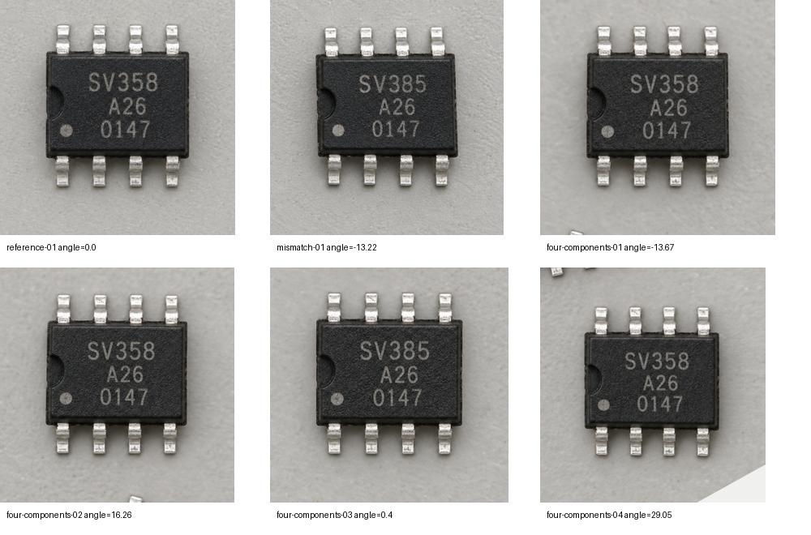

# 平板丝印检验工作台：交付与验证

日期：2026-10-01。此次交付是可在本机完整试用的版本；真实 MES、企业身份和华为实机验收仍依赖双方后续联调。

## 已交付

- [完整 PRD](平板丝印检验工作台PRD.md)：用户流程、规则、AI 输出、状态、风险和验收目标。
- [MES 协作方案](MES接口协作方案.md)：推荐三个 REST 接口、数据样例、幂等、版本与回执、身份/任务绑定、备选路线、独立 HTTP 接收示例。
- [使用与部署说明](平板工作台使用与部署.md)：本机试用、公司电脑迁移、相机、环境变量、数据保存和扩容边界。
- 默认平板工作台：任务创建、标准核对、照片续拍/移除/替换、自动定位裁剪、90° 方向修正、逐件真实模型比较、异常集中复核、批次汇总与回填。
- SQLite 持久化、不可变标准快照、照片/器件独立编号、原图留存、JSON/ZIP 报告、串行推理队列、取消/重启恢复、资源保护。
- 文件模拟 MES、可运行 HTTP 接收器及 HTTP 客户端。真实 MES 不存在时不会伪造生产回填成功。
- 原有图片对话 `/?view=chat` 和独立自主裁剪 Agent 继续保留；后者仍是 CLI/MCP 能力，未冒充网页按钮。

## 实际模型测试

环境：Mac Studio M2 Ultra、64 GiB，LM Studio 已加载 `hr-qwen`。参考图与四件图均由 ImageGen 生成，人工逐张核对文字后建立真值。

| 器件编号 | 人工读图 | 模型读图 | 模型建议 | 单件耗时 |
| --- | --- | --- | --- | --- |
| P001-01 | SV358 / A26 / 0147 | 相同 | PASS | 11.19 秒 |
| P001-02 | SV358 / A26 / 0147 | 相同 | PASS | 11.22 秒 |
| P001-03 | SV385 / A26 / 0147 | 相同，指出参考是 SV358 | FAIL，进入人工复核 | 11.39 秒 |
| P001-04 | SV358 / A26 / 0147 | 相同 | PASS | 10.65 秒 |

本批约 46.9 秒，排队约 0 秒。四个 JSON 均有效、无思考 token，模型结论与这四个合成样本的人工观察一致。第三件人工确认不合格后，汇总为 4 件中 1 件不合格、整项 FAIL；随后实际执行模拟回填并显示保存回执，`final_submission=false`。

[真实模型原文与测试记录](validation/2026-10-01-qwen-synthetic.json)。本次仅四件，不是 P90、现场准确率或误通过率估计，也没有达到“每张几秒”的体验目标。

## 自动定位和裁片检查

三张源图共六个目标：单件参考、倾斜单件、四件混拍。分别定位到 1、1、4 个，人工查看裁片中的文字和完整引脚，旋转后文字方向正常。近似方形目标采用较小旋转，避免轮廓长边误差导致无意义的 90° 转向。



当前使用矩形轮廓与旋转框，不是通用语义分割。四件图某些裁片边缘仍可能带少量邻件/背景；文字与主要器件区域完整，本轮模型未因此误判，后续需要现场图片进一步优化。角度规范化不能保证任意照片文字一定朝上，保留人工 90° 修正。

## 自动化检查

完整 Python 回归 63 项通过，前端几何 8 项通过。新检验模块含 19 项针对性用例，覆盖：

- 单件、多件、倾斜、空图、边缘截断、模糊、超过四件与单件模式误入多件。
- 严格 JSON、无效/截断输出、明确异常不能自动通过。
- 草稿持久化、不同配对身份隔离、同文件/同请求去重、停止/续跑、重启恢复。
- 原图字节不改写、旋转使旧结果失效、替换不复用编号、件数不符阻止回填。
- 人工复核保留原判，手动处理过的错误不会被后续续跑覆盖。
- 明确 PASS 才允许自动回填；图像警告、人工干预、异常均阻止自动回填。
- 多任务排队、HTTP 合同、附件摘要、版本冲突、生产身份/合成数据隔离。
- MES 已保存但响应丢失时同键查询回执，不重复保存；并发下载旧报告不能覆盖冻结报告。

TypeScript 检查、检验界面的 ESLint 检查、Vite 生产构建通过。Vite 应用不使用 Next 路由/图片优化器，相关 Next 专用 lint 规则仅对 `lan/` 关闭，其余规则保留。

复现：

```sh
agent-tools/image-focus/.venv/bin/python -m unittest discover -s agent-tools/image-focus/tests -q
node --test lan/src/geometry.test.mjs
npx tsc --noEmit --incremental false
npx eslint lan/src/inspection lan/src/main.tsx
npm run build:lan
```

## 亲自操作浏览器的检查

使用独立 `outputs/inspection-evaluation/ui-state` 和 5190 端口，未在日常 5188 数据目录预填任务。

- 首次配对、登记测试人员、主动加载合成样例、点击实际模型识别。
- 在 1280×800 横屏查看正品与待检图；800×1280 竖屏填写复核依据、确认不合格并模拟回填。
- 在 393×873 窄屏核对状态、件数、页面宽度，未发现横向溢出。
- 新建单件任务，从相册入口上传文件，展开裁片、旋转 90°，移除 P001 后补拍生成 P002，刷新后仍保留任务与 P002。
- 点击报告下载，确认浏览器触发 ZIP 下载；自动化测试同时核验 ZIP 内容与冻结报告摘要。
- 检查浏览器控制台，未发现错误/警告。恢复默认浏览器尺寸。
- 切回常用页面时发现旧 Cookie 名称跨端口冲突，已改为按服务状态独立命名，并兼容旧会话迁移。恢复原浏览器身份后，实际打开旧版 A7 对话，核对两轮问答和取景图完整保留；新增跨端口共享浏览器与旧会话迁移回归测试。
- 试用中发现“异常结果在照片列表下方、不易发现”，已改为异常优先展示及“查看待复核”主要动作。

此处是开发者走查，不代替首次使用检验员的可用性验收。电脑浏览器的响应尺寸模拟也不等于华为真机测试。没有声称实际拍过平板摄像头画面或完成软键盘、触摸、休眠和断网硬件测试。

## 资源与服务

推理前与运行期间检查 CPU、GPU 可取得的利用率、可用内存和系统热压力。此次检查未记录到系统热警告；没有测量或声称具体温度。模型逐件执行，图像处理限制为两个 OpenCV 线程，未结束用户其他进程。

常用服务保持 5188，健康检查和新检验 API 已验证，原有四个聊天记录保留。检验模型列表包含 `hr-qwen` 和 `sv-qwen4b`。新的配对身份进入空工作台，没有自动塞入测试记录。

## 上线前需要继续完成

1. MES 同事确认独立项目暂存、任务/项目 ID、人员认证授权、版本规则、附件限额与回执；按合同联调真实服务。
2. 企业登录、任务领取和公共标准审批库；当前浏览器独立身份只用于本地试用。
3. 华为平板型号/系统/浏览器，可信 HTTPS 与相机原图质量验证。
4. 用户拍摄的真实器件集合，覆盖封装、背景、反光、批号合法变化和异常；先定统计口径，再评估误通过率。
5. 同时活跃人数、到达率、每批件数和等待预算；当前单路约 11 秒/件，不代表百人同时推理能力。根据实测选择多实例和集中存储。
6. 企业备份、磁盘容量监控、原图保留期、权限回收、已回填修订和补检流程。
