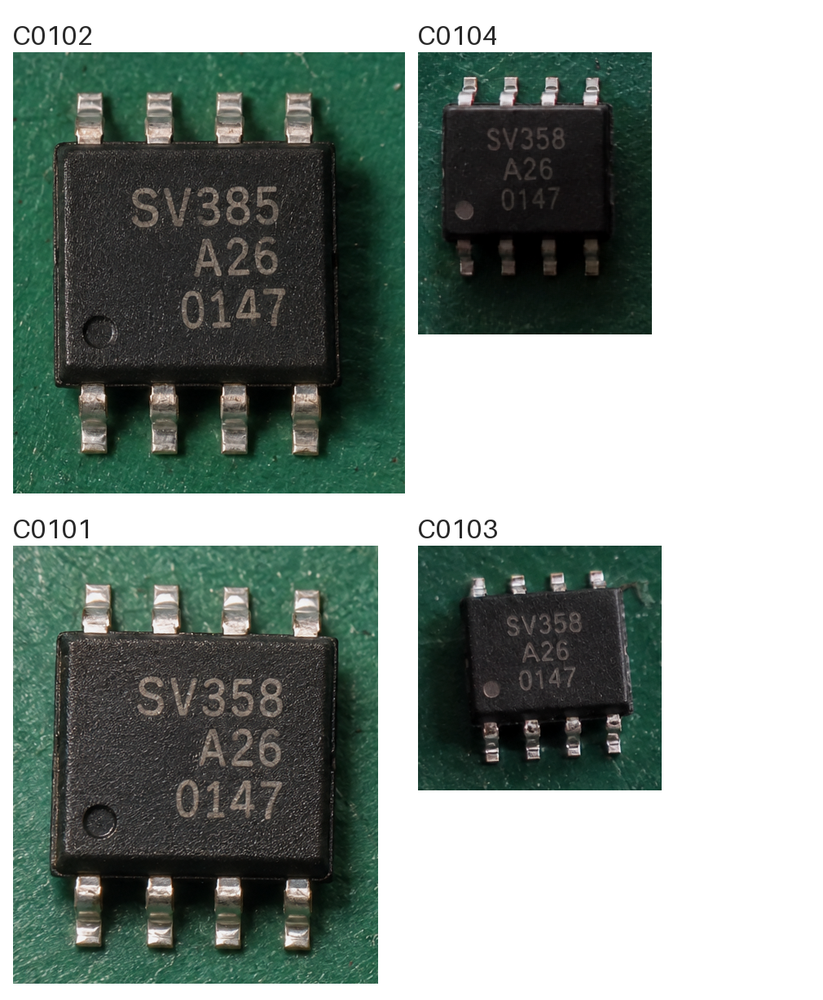

# EXP-008：固定前缀、Schema与换图缓存对照

日期：2026-10-18。状态：本机技术验证。模型：LM Studio 已加载的 `hr-qwen`，模型目录名 `Qwen3.8-27B-MLX-4bit`，配置架构 `qwen3_5`；MLX运行时1.11.0、Python SDK1.5.0。并发1，数值库2线程，temperature=0，逐请求关闭thinking，不修改模型全局配置。

## 结论

已把“固定规则与正品图在前、动态说明／编号与待检图在后”接入正常检验管线，并通过真实 `response_format` 参数传入JSON Schema。调试页可切换新旧两种输入顺序、两种输出约束。原有完整JSON、元件身份和业务关系校验继续保留，失败不自动降级为仅提示词约束。

**本机换新样品图没有获得缓存命中或速度提升。** 4件白板每条件换图4次，新顺序＋Schema总耗时中位25.29秒，旧顺序＋提示词22.08秒，本组慢约14.5%。文字与判定均为16/16正确，但只有4块生成裁片，不能换算成真实来料准确率。

保留固定前缀可为后续推理服务优化提供明确边界；本次交付的直接价值是输入可追溯、输出结构受约束，不能宣传为已经提速。正常工作台仍逐件识别，白板批量仍属于调试与研究。

## 实际输入顺序如何实现

不能只在一条消息内交换文本与图片数组的位置：当前LM Studio渲染会把同一消息中的图片提前，SDK也会合并连续的user消息。正式实验前已通过SDK历史对象和 `apply_prompt_template` 验证此行为。

新构造分为四条消息：

1. `system`：固定检测规则、字段含义与正品标准说明。
2. `user`：固定参照说明＋正品图。
3. `assistant`：固定协议确认语“请提供待检图片和对应的元件编号。”这只是消息分隔，不是对正品图的识别结果。
4. `user`：本次编号、现场补充说明＋待检图／白板。

真实工作台的现场说明优先规则仍保留；说明实际值不放入固定段，修改说明后仍按原业务逻辑重判。固定标准或正品图变更后本就不应复用旧的对应缓存。

四组预热均记录了默认模板渲染后的相对位置；新方式固定规则→正品图→待检图→动态编号，旧方式两张图片在规则和编号之前。`apply_prompt_template`没有使用逐请求关闭thinking的覆盖模板，因此这里只证明相对顺序，不冒充最终完整推理token序列；实际推理继续使用模型自身模板的关闭thinking版本，并保存模板哈希。最后一条消息内，运行时仍可能把待检图排在动态文字之前，两者均在固定段之后。

旧顺序与新顺序因此还存在system角色及固定确认语的差异，结果是整体编排方案对比，不能称为仅交换两个数组元素的纯粹实验。初次短试跑发现上述重排问题后已停止，原始排查记录在本机 `outputs/prefix-cache-20261018/run-01/`，不混入下方正式统计。

## 正式实验设计

- 复用[EXP-007](../whiteboard-batching/README.md)的C02／C03／C04／C06，1件型号为 `SV385`，其余为 `SV358`；其余两行均为 `A26 / 0147`，正品型号 `SV358`。
- 正品PNG431×419，4件白板1010×1226。裁片不缩小，编号在白底上。每轮使用不同编号、排列和轻微亮度变化；亮度变换是模拟照片变动，会改变像素，不将整个实验称为无损。
- A：旧顺序＋提示词JSON；B：旧顺序＋Schema；C：固定前缀＋提示词JSON；D：固定前缀＋Schema。
- 每条件预热1次不统计，随后4张变化白板均跑四条件；各张照片首先执行的条件轮换，降低视觉处理缓存及调用先后偏差。共20次，正式16次。
- 各条件在固定规则开头加入各自不变的实验标识，避免四条件之间复用KV导致归因不清。同一照片在四条件中的PNG字节、编号、最大输出1340 tokens一致，参考图始终相同。没有清理用户缓存或重启模型。
- 同一条件的变化样片只来自4块既有生成裁片，**不是16个独立元件，也不是真实平板实拍**。明暗程度有限，未覆盖模糊、反光、长丝印、遮挡及无法判定情形。
- 缓存证据取自每次调用前后的引擎日志字节区间，仅接受区间内唯一一条 `Prompt cache restore`；不使用历史累计 `lifetime_efficiency` 充当本次命中率。资源检查每3秒一次，CPU、可用内存和可取得的系统热状态都有记录，没有温度传感器读数。

## 换新样片结果

以下均为每条件4次的中位数；总耗时含SDK连接与图片准备，不含共用定位裁剪、白板制作、休息及返回后的离线评分。

| 条件 | 总耗时 | SDK首token | 输出tokens | 解码token/s | 换图缓存命中 | 文字／判定正确 | 完整合同通过 |
| --- | ---: | ---: | ---: | ---: | ---: | --- | --- |
| A 旧顺序＋提示词 | 22.08秒 | 10.66秒 | 348 | 31.87 | 0/4次 | 各16/16 | 4/4 |
| B 旧顺序＋Schema | 24.94秒 | 10.66秒 | 428.5 | 30.59 | 0/4次 | 各16/16 | 4/4 |
| C 固定前缀＋提示词 | 29.52秒 | 11.01秒 | 583.5 | 31.78 | 0/4次 | 各16/16 | 4/4 |
| D 固定前缀＋Schema | 25.29秒 | 11.00秒 | 432 | 30.59 | 0/4次 | 各16/16 | 4/4 |

16次正式调用的引擎缓存均为0 tokens，旧方式每次展开输入1853 tokens，新方式1888 tokens。统计没有用SDK的 `promptTokensCount` 替代图像展开后的总量。

| 变化白板 | A总耗时 | B总耗时 | C总耗时 | D总耗时 |
| --- | ---: | ---: | ---: | ---: |
| 1：亮度0.96 | 21.78秒 | 24.40秒 | 29.45秒 | 25.15秒 |
| 2：亮度0.91 | 20.99秒 | 25.57秒 | 29.59秒 | 25.26秒 |
| 3：亮度1.05 | 24.04秒 | 24.73秒 | 30.60秒 | 25.31秒 |
| 4：亮度0.88 | 22.39秒 | 25.16秒 | 29.25秒 | 26.01秒 |

本组所有条件没有误放行、误拒绝、漏项、重号或字符编辑错误。各条件相同样片的判断一致，未观察到编排或Schema导致识别质量下降；样本太少，不能据此证明等效准确率。

## 为什么没有变快

首token等待仍约11秒，不能仅凭此拆成视觉编码、预填充和调度的精确耗时。thinking关闭，记录的推理tokens为0，因此没有证据说主要耗时来自“思考过程”。

新顺序＋Schema相对A的输出中位数由348增至432，约多24%；解码约31 tokens/s。输出更长足以解释相当一部分额外耗时。C的输出更长，D相对C反而较快。Schema在本组略降低解码速度，但采样太少，不能把整个差额都归因为约束解码自身的计算开销；提示格式、角色编排会一起影响生成内容。

Schema约束的是所声明的结构。本次D有8/16条元件输出包含2条 `features`，超过提示词的“最多1条”；现有Schema未声明这一上限，因此完整结构校验仍通过。此处保留为软指令偏离，不能说“完全遵守所有提示”。后续若压缩输出，应独立比较将适用上限写入Schema、减少说明字段或分开简报与详细报告的效果，不将其混入本轮结论。

## 连续调用补充验证

为排除四条件交错调用的影响，另做6次连续探针，各条件按“旧图原样重复→此前未推理的新图→新图原样重复”执行。沿用各条件已有固定前缀；新图为同4块裁片的新亮度0.935、新排列与新编号，不重复计入正式4次换图中位数。

| 条件与操作 | cached／uncached tokens | SDK首token | 总耗时 |
| --- | ---: | ---: | ---: |
| A：旧图重复 | 1792／61 | 0.855秒 | 12.702秒 |
| A：换全新图 | 0／1853 | 11.320秒 | 21.665秒 |
| A：新图原样重复 | 1792／61 | 0.804秒 | 11.148秒 |
| D：旧图重复 | 0／1888 | 10.980秒 | 25.208秒 |
| D：换全新图 | 0／1888 | 11.001秒 | 25.394秒 |
| D：新图原样重复 | 0／1888 | 11.004秒 | 25.377秒 |

6次结构、文字、判定均通过，原文和资源检查见[连续探针结果](cache-probe-results.json)。A的重复输入命中约96.7%，证明本机缓存并非整体关闭；换图则失效。**D连原样重复也未命中，不能只用“共享前缀没有检查点”解释所有现象。** 已核对最后两次D的传输前消息、图片元数据完全相同；模型内部最终输入、缓存落盘及恢复路径尚未逐项定位，故保留为当前运行时对多消息编排的兼容／恢复问题待查，不宣称唯一根因。

复现连续探针：

```bash
agent-tools/image-focus/.venv/bin/python next/research/prefix-cache/benchmark.py prepare-probe --source outputs/prefix-cache-new --out outputs/prefix-cache-probe-new
agent-tools/image-focus/.venv/bin/python next/research/prefix-cache/benchmark.py run --out outputs/prefix-cache-probe-new
node next/research/prefix-cache/summarize.ts outputs/prefix-cache-probe-new --publish
```

## 缓存机制排查

[LM Studio的缓存说明](https://lmstudio.ai/blog/mlx-engine-agentic-workloads)介绍按块保存和恢复缓存，不能据此推断本机任意共享前缀都能恢复。已只读核对安装版本对应源码并保存[版本与文件哈希](backend-evidence.json)。当前模型配置是混合线性注意力／完整注意力的 `qwen3_5`。

本机源码中的 `_next_prompt_step_size` 对 `ArraysCache`选择可保存的末尾边界；保存时只有模型调用结束位置才有精确状态检查点，恢复器要求目标块具备精确检查点。固定前缀位于变化图片之前，并不自动意味着该处已有可恢复状态。参见对应版本的[生成器源码](https://github.com/lmstudio-ai/mlx-engine/blob/ec2f585/mlx_engine/model_kit/batched_vision/batch_generator.py)和[官方实现说明](https://github.com/lmstudio-ai/mlx-engine/pull/326)。这是换图零命中的机制解释候选，不能解释全部D原样重复结果；**尚未通过修改运行时、记录每个检查点的对照实验确认根因**。

不能在此把0命中归因为用户没有开启缓存，也不能因改了顺序就宣称未来服务器必然提速。未来vLLM／NVIDIA服务仍需按同样的新图、原图重复、实际缓存与吞吐指标重新验证。

## 正常检验管线回归与交付

使用独立SQLite和文件目录，调用真实 `LocalVisionPipeline`，不修改日常试用任务，不向MES提交。先由正常服务定位、裁剪双件照片并逐件调用模型，再单独验证现场说明允许型号变体的真实识别调用。

| 真实调用 | 结果 | 丝印 | 模型调用耗时 |
| --- | --- | --- | ---: |
| 正常流程：正确件 | PASS | SV358／A26／0147 | 11.837秒 |
| 正常流程：型号差异件 | FAIL | SV385／A26／0147 | 12.773秒 |
| 复用差异裁片，现场说明允许SV385变体 | PASS | SV385／A26／0147 | 14.714秒 |

前两件合计1合格、1不合格，任务总判不合格，2件均有明确结果后才可提交。三个请求均实际发送 `prefix-first` 与 `json-schema`。原始返回与配置见[管线验证材料](integration-results.json)，复现命令为 `node next/research/prefix-cache/probe-integration.ts`。

现场允许变体时，模型判定及差异描述正确，但 `instructionConflicts` 仍漏填；系统已有的独立提示检测到“有差异却按现场说明放行”，保留原文并另存追溯提醒，没有把系统补充冒充模型原文。Schema不能独自解决这种语义漏报。

29项Node测试、14项Python测试、应用TypeScript检查、研究脚本严格类型检查、前端构建均通过。新增测试覆盖正常管线的Schema参数、输入默认值、旧配置兼容及Schema失败不降级。浏览器核对了默认新配置、新旧选项切换、真实记录的输入角色／图片与耗时展示。

主服务已重启并经 `/api/health`确认 `prefix-first / json-schema` 生效。重启前后任务、轮次、审计与模拟回执的整体哈希一致，原有业务数据未改变。所有实验串行，正式实验期间CPU采样峰值37.0%、可用内存最低14.80GiB，未取得系统热／性能告警；没有实际温度测量。资源检查不等于温度保证。

兼容旧配置可设置 `SV_VISION_INPUT_LAYOUT=legacy`、`SV_VISION_SCHEMA=0` 后重启本系统；两个开关独立，亦可保留Schema只对照旧顺序。无需重启或更改共享LM Studio。

## 复现与证据

[results.json](results.json)包含清单、图片哈希、精确原文、SDK统计、缓存日志、资源采样、逐件评分及顺序验证。完整流事件和输入PNG在本机被Git忽略的 `outputs/prefix-cache-20261018/run-02/` 及调试记录目录。调试窗口搜索 `EXP-008` 可查看正式组，预热标签为“换图0”。

```bash
agent-tools/image-focus/.venv/bin/python next/research/prefix-cache/benchmark.py prepare --out outputs/prefix-cache-new
agent-tools/image-focus/.venv/bin/python next/research/prefix-cache/benchmark.py run --out outputs/prefix-cache-new
node next/research/prefix-cache/summarize.ts outputs/prefix-cache-new --publish
```

输出目录必须是新目录；脚本拒绝覆盖或静默重试失败调用。模型需事先加载，脚本检查空闲状态，不自动加载、卸载或调整缓存。原文不合规会保留错误，不拼补或按顺序猜编号。


