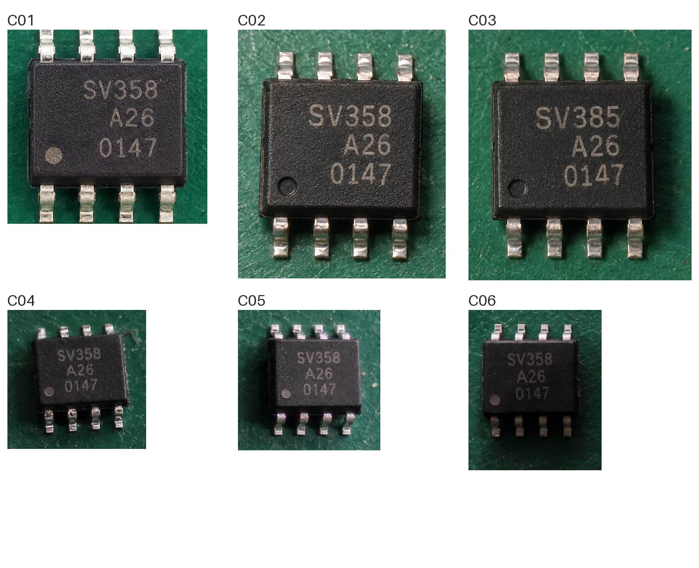

# EXP-007：4／6件白板与逐件识别对照

日期：2026-10-18。状态：**本机离线实验已完成，日常工作台仍采用逐件识别。**

## 结论与主要数据

本组生成样本中，4件、6件白板均能正确返回每个元件的丝印和合格／不合格结论，没有观察到漏项、串号、误放行或误拒绝。首次输入该白板时，模型调用时间相对同轮逐件累计减少约28%。这支持继续验证白板路线，**还不能证明真实来料准确率不下降**。

| 同一组裁片，首轮 | 逐件累计 | 一次白板 | 减少耗时 | 文字整件完全一致 | 判定正确 |
| --- | ---: | ---: | ---: | --- | --- |
| 4件，含1件错序、暗光裁片 | 32.16秒 | 23.21秒 | 27.8% | 两种方式均4/4 | 两种方式均4/4 |
| 6件，含1件错序、3件暗光裁片 | 44.42秒 | 32.15秒 | 27.6% | 两种方式均6/6 | 两种方式均6/6 |

白板在CPU上合成并编码PNG，4件中位56.29ms，6件中位77.44ms；每组另测3次，PNG哈希与实际模型输入相同。把这一小段合成时间加回，不会明显改变上述对比。模型墙钟包含SDK连接、图片准备上传、预填充及JSON生成，不包含共用的定位裁剪或人为轮间休息。没有把多张逐件识别的后台并行吞吐与白板混为一谈，本轮所有请求串行。

## 缓存与换排布复核

| 条件 | 4件白板 | 6件白板 | 说明 |
| --- | ---: | ---: | --- |
| 首次输入原排布 | 23.21秒 | 32.15秒 | 主表采用这一行 |
| 原图原提示再次输入 | 12.77秒 | 18.28秒 | 同组逐件累计也缩短为18.18／27.64秒 |
| 改为逆序摆放、标签与裁片保持绑定 | 23.35秒 | 32.20秒 | 仍全部读对、判对，无串号 |

6件白板的SDK首token等待从14.913秒降到重复输入时的1.059秒；输出token数均为543，生成速度都约32 tokens/s。换排布后首token又为14.899秒。这与输入／前缀缓存带来的收益一致，但**没有直接测量缓存内部实现**。不能拿18.28秒当作新照片的常规性能，也不把两轮中位数作为消除缓存影响后的稳定结论。

## 耗时进一步拆解与实时调试（2026-10-18补充）

| 首轮 | SDK首token等待 | 生成token数 | 生成速度 | token数÷速度的量级估算 | 调用墙钟 |
| --- | ---: | ---: | ---: | ---: | ---: |
| 单件C02 | 4.907秒 | 102 | 32.72 token/s | 约3.12秒 | 8.14秒 |
| 4件白板 | 11.067秒 | 385 | 32.10 token/s | 约11.99秒 | 23.21秒 |
| 6件白板 | 14.913秒 | 543 | 31.80 token/s | 约17.07秒 | 32.15秒 |

主要耗时在模型调用侧。白板合成仅约0.06～0.08秒；拼成一张图并不会使4／6件的输出变成单件长度。首token等待含图像处理、预填充等，SDK不提供其内部可靠分项，不能都归因为思考；本轮关闭thinking，观测推理token为0。生成时间列只是由SDK统计作量级估算，不是新增的独立阶段计时。

已新增[模型调试窗口](http://127.0.0.1:5190/debug/model)与[使用及计时口径](../../docs/模型调试窗口与耗时口径.md)。可查看真实图片、完整提示词、流式原文、首token、首段输出、各元件对象完整及整批校验的时刻。旧18次非预热调用已按哈希核对导入，历史缺失的逐件时间明确显示未记录。

追加4件调试实测（同样图片已有缓存，**不是重做首轮性能对照**）：

| 配置 | 首段正文 | C02完整 | C03完整 | C04完整 | C06完整 | 生成结束 | 整批校验结束 |
| --- | ---: | ---: | ---: | ---: | ---: | ---: | ---: |
| 提示词JSON | 1.19秒 | 3.79秒 | 7.68秒 | 10.28秒 | 12.77秒 | 13.02秒 | 13.25秒 |
| 生成时JSON Schema | 2.48秒 | 5.66秒 | 10.13秒 | 13.06秒 | 15.97秒 | 15.97秒 | 16.18秒 |

时刻均从本次输入快照起点计算，来自客户端实际接收事件；前端400ms轮询仅影响显示。提示词版各件区间为2.60／3.89／2.60／2.49秒；第二件包含差异描述，输出字段较多。Schema版生成419 tokens、约30.93 token/s，提示词版385 tokens、约32.20 token/s；不能据这两个有缓存的单次观测断言Schema必然更慢或更快。Schema还改变了生成字段顺序，扫描器仍按实际输出顺序记录完整对象。原始事件见[timing-details-20261018.json](timing-details-20261018.json)，两次均完整返回4个编号。

关于“是否严格遵从”：原EXP-007没有传生成时Schema，仅提示词＋后置严格校验。18次非预热调用中6次原文带代码围栏，违反了纯JSON的提示要求，但解析器允许去掉完整单层围栏，所以合同校验通过；没有补字符、修编号或接受损坏JSON。EXP-006中还发现规则冲突说明漏填，这是内容层问题，结构Schema也不能保证解决。

新调试入口已实际调用SDK的`response_format`验证当前MLX模型能使用JSON Schema；日常检验默认调用方式暂未切换。Schema约束结构及部分枚举／长度，不能保证OCR或业务语义：本次模型输出2条`features`，超过提示词要求的1条，但该长度未写入Schema，因此结构校验仍通过。不能将“Schema通过”称为“完全遵循全部要求”或“识别准确”。

## 数据和控制条件

- 使用与[EXP-006](../real-vision/README.md)相同的3张生成照片，经当前OpenCV定位、转正后得到6块不同裁片。白板4件为C02、C03、C04、C06；白板6件为C01～C06。C03为`SV385 / A26 / 0147`，其余为`SV358 / A26 / 0147`。
- 正品为已保存的正品裁片。C01与正品来自同一张图，是简单链路对照，不是独立正品照片。
- 本机已加载`hr-qwen`（`qwen3.8-27b-mlx`，MLX 4bit，模型列表SIZE约16.08GB），SDK1.5.0，temperature=0，逐请求关闭thinking，模型并行数为1。没有改动共享模型的加载配置或TTL。
- 一次仅输入两张图：正品＋单件裁片，或正品＋白板。两种方式使用同一套检测规则、JSON字段和说明字数上限。实验要求理由不超过30字，所以这里的逐件时间不能直接与EXP-006较长说明的时间混算。各次生成文本并非逐字相同，输出长度也是耗时的一部分。
- 先做1次预热，不计入统计。第一轮逐件6次→4件白板→6件白板；第二轮反向先6件→4件→逐件逆序6次。额外各做一次逆序排布白板。共19次调用，其中1次预热、12次逐件、6次白板。
- 预热使用C01，首轮6件逐件对照再次包含C01，因此该组并非全部冷输入；4件子集不含C01。本文的“首次”指白板图片首次输入，并不代表重启服务、清除全部模型缓存后的冷启动。
- 6次白板共30条元件输出，文字整件完全一致30/30、判定正确30/30；12次逐件均正确。**这些是重复观察，不是42个独立样本，更不是生产准确率100%。** 白板批次JSON合同全部通过，误放行、误拒绝、漏项、重号、额外编号和字符编辑错误本次均为0。
- 两个白板尺寸分别1010×1226、1507×1226。裁片只平移粘贴，未缩放；编号置于白底上。单元测试及生成时断言逐块比较RGB像素，证明拼图阶段未改变裁片内容。几何转正此前使用过插值，不能把整条预处理链称为完全无损。
- 每个请求保存实际发送的PNG尺寸、字节数、SHA256；模型内部有效尺寸未知，明确记为null。没有修改LM Studio图像预处理参数，也不将SDK的`promptTokensCount`解释成完整视觉token。

## 白板样例

[4件原排布](examples/sheet-4.png) · [6件原排布](examples/sheet-6.png) · [4件逆序](examples/sheet-4-permuted.png) · [6件逆序](examples/sheet-6-permuted.png)。这些PNG就是对应调用的输入字节，可以按哈希核对。



## 评分与证据

[results.json](results.json)包含人工检查清单、裁片与白板哈希、各轮原始回答、SDK统计、资源检查、逐件评分及同组对照。完整SDK流事件保留在本机被Git忽略的`outputs/whiteboard-batching-20261018/run-01/`。

- 严格校验整个JSON、结束状态与ID集合，模型返回顺序可不同，但不按数组位置匹配，不把`C2`修成`C02`。
- 文字评分保留原文和行序，不删除空格／猜补字符。字符差异用确定性字符串对齐计算。合格／不合格另行评分。
- 若缺项、重号或结构错误，整批无效；离线诊断可以检查按唯一已知ID返回的单条内容，但不把部分诊断当作可提交结果。
- 置信度仅模型自评。没有构造Logo、封装造型或颜色缺陷，因此本次不能验证这些维度的检出率；也未自动评价自然语言解释是否完全准确。

## 工程判断

**当前路线可行，优先把4件作为后续真实照片试用的候选批量大小，6件保留为可配置候选。** 这是工程上的保守建议，不表示4件已证明比6件更准确。若局部不清晰、批次漏项或JSON失败，下一步适配器应保留已完成证据，并把受影响元件转逐件重试；仍不清晰则要求重拍，不能部分回填MES。

并非一次塞4／6件就获得4／6倍加速：模型仍要生成每件JSON，且更大的白板增加图像预填充。当前统一格子也会引入白色空隙；本轮两种方式累计发送的像素数接近。因此“减少请求次数”不等于同倍降低视觉运算量。紧凑排版、减少非必要输出字段可后续单独试验，不能混入本轮结论。

下一步需要真实平板照片、不同封装与尺度、不同差异字符位置、强反光／失焦、更多异常件及未见过的丝印。尤其要用多种不同文字的元件排除“多数都一样、模型复制正品也能碰巧答对”的风险。本轮6个裁片、多次重复及换位远不足以覆盖这些情况。

## 代码验证

类型检查、前端构建、26项Node测试和9项Python测试通过；覆盖批量ID匹配、漏项／重号／截断拒绝、坏格式离线评分、像素不变的拼图及既有单件链路。合成计时CLI另经临时目录试跑，验证4／6件PNG哈希一致，并拒绝覆盖已有计时证据。测试不向当前检验任务写入照片或提交结果。

## 复现和本机负载

使用现有Python视觉环境及已加载的LM Studio模型，选择新的输出目录，避免覆盖原始证据：

```bash
agent-tools/image-focus/.venv/bin/python next/research/whiteboard-batching/benchmark.py prepare --out outputs/whiteboard-batching-20261018/run-new
agent-tools/image-focus/.venv/bin/python next/research/whiteboard-batching/benchmark.py run --out outputs/whiteboard-batching-20261018/run-new --repeats 2
agent-tools/image-focus/.venv/bin/python next/research/whiteboard-batching/benchmark.py permute --out outputs/whiteboard-batching-20261018/run-new
agent-tools/image-focus/.venv/bin/python next/research/whiteboard-batching/benchmark.py time-compose --out outputs/whiteboard-batching-20261018/run-new
node next/research/whiteboard-batching/summarize.ts outputs/whiteboard-batching-20261018/run-new
```

`summarize.ts`增加`--publish`才会明确更新仓库的精简结果与样例图。该脚本针对本机Mac／LM Studio CLI，其他运行平台须调整命令及重新测量。实验单请求上限110秒、输出预算随元件数增长；既有日常逐件传输默认55秒不变。

OpenCV／数值库限制2线程，推理串行；每次调用前后检查可用内存、CPU利用率和可取得的系统热状态，低于8GiB或有系统热／性能告警时停止。本轮没有取得具体温度，检查时系统未报告上述告警。模型始终由用户预先加载，实验没有加载、卸载或终止用户的模型服务。当前试验全部完成，模型回到空闲。
